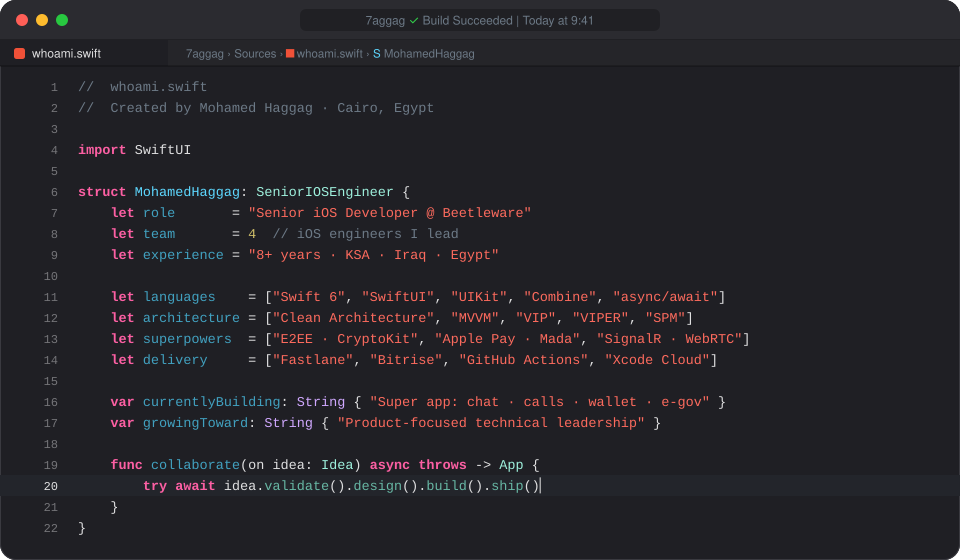

  

  
  
  
  

  

### 📱 Shipped to the App Store

  

  <a href="https://apps.apple.com/sa/app/id1622681127"><b>Aseel</b></a> ·
  <a href="https://apps.apple.com/sa/app/id1670005354"><b>Tameer Business</b></a> ·
  <a href="https://apps.apple.com/sa/app/id6471635089"><b>Istend</b></a> ·
  <a href="https://apps.apple.com/sa/app/id6451219833"><b>Flex Kitchen</b></a> ·
  <a href="https://apps.apple.com/sa/app/id6468938766"><b>Healthy &amp; More</b></a> ·
  <a href="https://apps.apple.com/app/id1356046237"><b>Physio Home Training</b></a>
   
  Super App and Sahn &amp; Rageef are client apps built at Beetleware for Iraq and Saudi Arabia.

### 🧭 The journey so far

  

  Every asset here is hand-written SVG, generated by <a href="tools/build_assets.py"><code>tools/build_assets.py</code></a>. No JavaScript, no third-party widgets.

